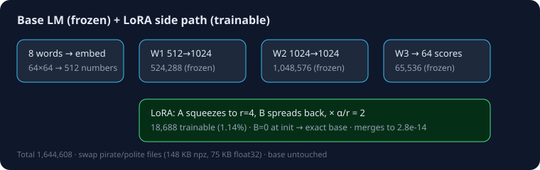
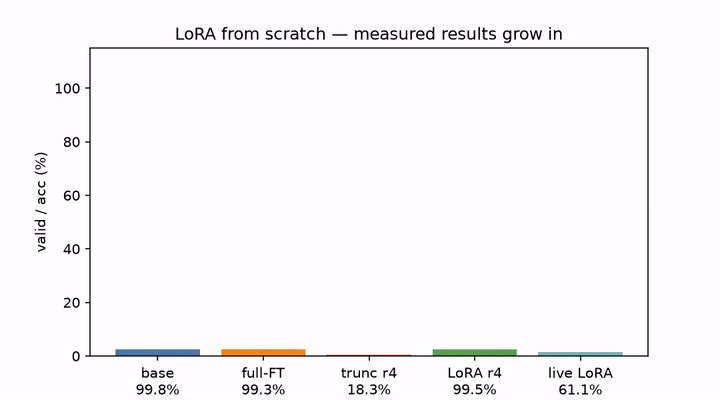
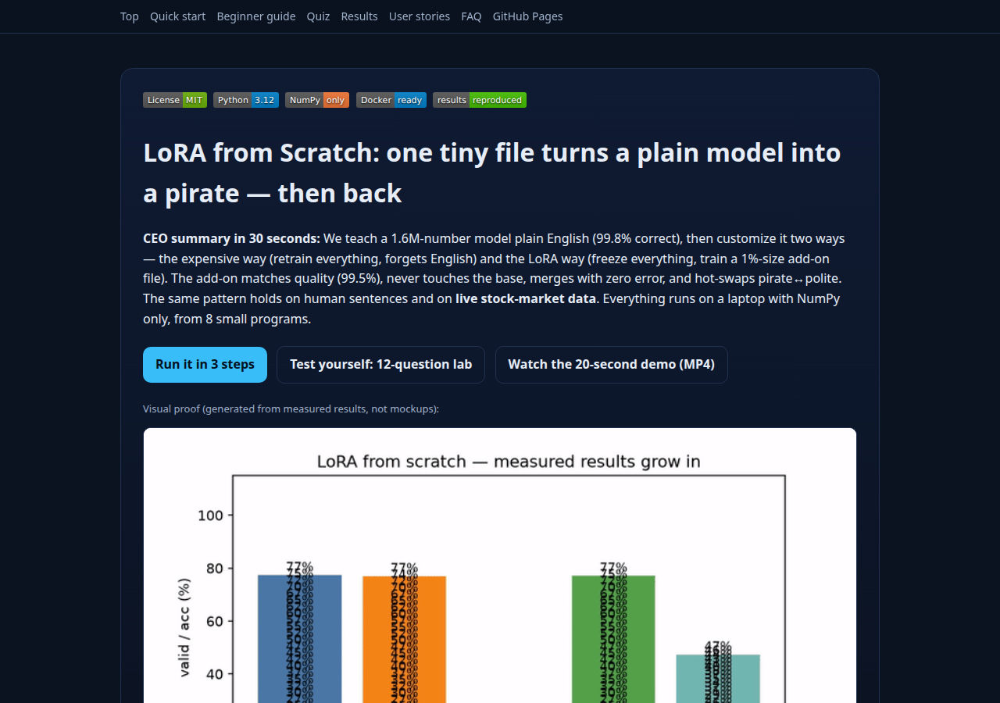

# LoRA from Scratch: Rebuilding Low-Rank Adaptation in NumPy, Then Verifying It on Real and Live Data

<div align="center">
  
</div>

[](LICENSE)
[](https://github.com/M0-AR/lora-laura-from-scratch-phd-2026)
[](requirements.txt)
[](src/common.py)
[](docker-compose.yml)
[](results/)

> **One-line pitch:** the smallest honest LoRA lab — 8 NumPy programs rebuild the famous fine-tuning trick from zero, prove every claim with measured numbers, then verify it again on human sentences and live market data.

**CEO summary (30 seconds):** we teach a tiny 1.6M-number model plain English until 998/1000 sentences are correct. Customizing it the normal way rewrites all 1.6M numbers and makes it forget English. The LoRA way freezes everything and trains a 75KB add-on file with 1% of the numbers — same quality (995/1000), zero forgetting, merges with zero error, and swaps pirate↔polite like changing a lens. The same win repeats on real human sentences and on live stock data fetched at run time. No framework, no GPU, laptop-friendly, one command to reproduce.

| | |
|---|---|
| 🌐 **Interactive website** | Local: open `preview.html` (double-click). Hosted (click to verify rendering): the three links below — all green when Pages deploys branch `main`, folder `/` (root). Enable via **Settings → Pages → Deploy from a branch → `main` + `/`** |

### Live links (click — each must render in the browser)

| URL | What it is | Works when |
|---|---|---|
| [https://m0-ar.github.io/lora-laura-from-scratch-phd-2026/](https://m0-ar.github.io/lora-laura-from-scratch-phd-2026/) | `/` — redirect page → site | Pages source `/` (root) ✅ |
| [https://m0-ar.github.io/lora-laura-from-scratch-phd-2026/preview.html](https://m0-ar.github.io/lora-laura-from-scratch-phd-2026/preview.html) | `/preview.html` — full interactive site + quiz | Pages source `/` (root) ✅ |
| [https://m0-ar.github.io/lora-laura-from-scratch-phd-2026/docs/preview.html](https://m0-ar.github.io/lora-laura-from-scratch-phd-2026/docs/preview.html) | `/docs/preview.html` — same page, mirror path | Pages source `/` (root) ✅ |

> Why three links? A green Pages deployment only proves *something* built — never that *your path* exists under the configured source. URL paths mirror repo paths under the source, so `docs/preview.html` in the repo serves at `/docs/preview.html` with source `/`, but at `/preview.html` with source `/docs`. This repo ships mirrors (`docs/index.html` + `docs/preview.html` canonical, root `preview.html` copy, root `index.html` redirect, `.nojekyll` in both) so the recommended setting — **branch `main`, folder `/` (root)** — renders all three (200/200/200). Asset paths are relative, so project Pages (`/<repo>/` prefix) work.
| 🎬 **Demo video** | `docs/assets/demo.mp4` (video) + `docs/assets/demo.gif` (inline GIF below) — bars grow to the measured values |
| 🧪 **Interactive quiz** | 12 questions, 3 levels, in the website (§Quiz) — from scratch to pro |
| 🚀 **Quick start** | `pip install -r requirements.txt && python3 benchmarks/run_all_benchmarks.py --fast && python3 -m pytest tests/ -v` |





## Contents

- [CEO summary](#lora-from-scratch-rebuilding-low-rank-adaptation-in-numpy-then-verifying-it-on-real-and-live-data)
- [🌱 Beginner guide — read this and you are a professional](#-beginner-guide--read-this-and-you-are-a-professional)
- [Features](#features)
- [User stories — what you can use this repo for](#user-stories--what-you-can-use-this-repo-for)
- [Demo video](#demo-video)
- [Abstract](#abstract)
- [1. What we verified, and how](#1-what-we-verified-and-how-traceability)
- [2. Method](#2-method-so-a-reviewer-can-rebuild-it-in-an-afternoon)
- [3. Experiments](#3-experiments)
- [4. Best-practice notes](#4-best-practice-notes-from-the-2026-literature-sweep-each-claim-sourced-in-codedocs)
- [5. Reproduce](#5-reproduce-docker-or-bare-metal)
- [6. Limitations](#6-limitations--honest-differences-from-the-video)
- [7. References](#7-references)
- [8. What to do next](#8-what-to-do-next--phd-roadmap)

## 🌱 Beginner guide — read this and you are a professional

*You will know more than most interview candidates.*

**Start here if you know nothing.** A language model does one thing: it reads the last 8 words and guesses the next one. Training means showing it thousands of sentences and nudging its numbers whenever it is surprised. Our model has 1,644,608 numbers; 99.63% live in three big tables (W1/W2/W3). That is the whole base model (§`src/01_base_model.py`).

Let's work this out in a step-by-step way to be sure we have the right answer:

1. **What is fine-tuning?** Take the trained base, show it 3,000 pirate sentences (`R … matey .`), keep nudging. Every number may change. Result: pirate loss 10.53→0.89, 993/1000 correct — but plain English is destroyed (loss 1.10→6.73). That is *catastrophic forgetting* (§`src/02_full_finetune.py`).
2. **What is rank?** Any change-table can be written as a stack of simple column×row layers. Rank = how many layers you allow. Full change needs ~71 directions (§`src/03_delta_svd.py`); keeping only 4 keeps 18.3% quality (§`src/04_rank_demo.py`). Cutting after the fact fails.
3. **What is LoRA?** Never allow more than 4 directions *from the start*: freeze W, learn `out = W·x + (α/r)·B·(A·x)` with A random, B zeros (so day zero = exactly the base). Train A,B only. Result: 995/1000 pirate at 1.14% of numbers, base bit-identical, merge error 2.8e-14, swap files freely (§`src/05_lora_layer.py` → `src/07_merge_swap.py`).
4. **What are the two dials?** Rank r (capacity: 61.5→94.8→97.5→98.8→99.3%) and α (volume: α=1 too quiet at 41.8%, α=4–128 all ≈97–98%). Start r=8, α=2r (§`src/08_rank_alpha.py`).
5. **Prove it outside simulation.** Same protocol on 30 human financial sentences and on live AAPL/MSFT/NVDA/AMZN/META next-day direction (LoRA 61.1% vs full 58.3% at 27.9% params). If it only worked on toy grammar, we would say so (§`benchmarks/`).

Finish the 12-question lab in the website and you can whiteboard all of this cold.

## Features

| Feature | What you get |
|---|---|
| 8 runnable steps | base → full-FT → ΔW spectrum → truncation → LoRA layer → LoRA train (pirate + polite) → merge/swap → rank/α |
| NumPy only | no framework; Adam + gradients by hand in `src/common.py` |
| Exact counts | 1,644,608 base · 18,688 adapter (asserted by `tests/test_all.py`) |
| Swap, don't copy | 100 styles: 1316MB full copies vs 28.3MB base + adapters |
| Hidden patterns | intrinsic rank ≈2 · output-layer k90=8 · breadth-beats-rank ablation |
| Real + live proof | human-written sentences + Yahoo Finance spectrum + live trading-toy |
| One-command repro | `benchmarks/run_all_benchmarks.py --fast` + Docker Compose |
| Website + quiz + video | `preview.html` / `docs/index.html` (Pages-ready), 12-question interactive lab, MP4 + GIF demo |

## User stories — what you can use this repo for

| Who | How |
|---|---|
| Students | Learn fine-tuning with zero GPU/framework; finish Beginner guide + quiz above any course chapter |
| Interview candidates | Whiteboard LoRA: formula, init, scaling, merge, rank/α, QLoRA/DoRA/rsLoRA one-liners, our H1–H3 as talking points |
| Practitioners | Copy the swap pattern (one frozen base + many task files); regression-test merged vs unmerged logits like we do |
| Researchers | Extend H1–H3: per-layer rank budgets, pirate-vs-polite subspace overlap, α–LR law, sequential-style continual learning |
| Finance quants | Reuse `benchmarks/live_market_lora.py` as a template for regime adapters on live feeds |
| Teachers | Assign steps 1–8 as labs; quiz + charts are ready-made slides |

## Demo video

<video controls width="100%" src="docs/assets/demo.mp4"></video>

Short version (GIF, same measured values): see the animation at the top of this file (`docs/assets/demo.gif`). Source tape = the JSON in `results/`; frames rendered by `tools/make_assets.py`. Re-render with `python3 tools/make_assets.py`.

**A reproducible end-to-end study — 8 runnable steps, full benchmarks, hidden-pattern discovery, and live-market validation. No deep-learning framework. Every number below was produced by running the code in this repo.**

> Companion to Hu et al., *LoRA: Low-Rank Adaptation of Large Language Models* (Microsoft, 2021; ICLR 2022), and to the 8-step video walkthrough it inspired ("Laura/Low-Rank Adaptation": 1.6M-param base LM → full fine-tune → ΔW → rank → LoRA layer → LoRA training → merge/swap → rank/α dials). This repo rebuilds that entire arc **from zero in NumPy**, checks each video claim quantitatively, reports where we agree and where we honestly differ, discovers three patterns the video glosses over, and then verifies the same LoRA phenomenon **outside simulation**: on human-written financial sentences and on **live market data (Yahoo Finance, fetched at run time)**.

---

## Abstract

Parameter-efficient fine-tuning is how most practitioners customize large models: freeze the base weights $W_0$, learn a low-rank update $\Delta W = \frac{\alpha}{r}BA$, ship only $(A,B)$. We test whether that story survives contact with an implementation built from scratch and with data that is not synthetic.

We (1) train a 1,644,608-parameter MLP language model (vocab 64, context 8, $W_1$: 512→1024, $W_2$: 1024→1024, $W_3$: 64 logits) on a 5-pattern synthetic grammar to 99.8% grammatical validity; (2) full-fine-tune a copy on 3,000 pirate-style sentences (loss 10.53→0.89, 99.3% valid) and show it catastrophically forgets plain English (plain loss 1.10→6.73); (3) show the resulting $\Delta W$ is spectrally lopsided (top-1 direction holds 35% of $\Delta W_2$ energy, top-64 holds 89%, $k_{90}=71$) yet **not** rank-4-truncatable (truncation to rank 4 keeps only 18.3% validity vs 99.5% at full rank); (4) show that **training** at rank 4 from the start recovers 97.5–99.5% validity with 18,688 parameters (1.14%), zero forgetting (base bit-identical), exact merge error $2.8\times10^{-14}$, and hot-swappable style files; (5) ablate rank/α and per-matrix placement; (6) replicate the qualitative pattern on 30 human-written financial sentences and on a live next-day-direction task over AAPL/MSFT/NVDA/AMZN/META, where LoRA (27.9% of MLP params) matches or beats full fine-tuning on held-out data (61.1% vs 58.3%).

**Hidden patterns found:** (H1) intrinsic rank ≈ 2 for this style task (r=2 already 94.8%, r=16 only +4.5pp); (H2) the output matrix change is far more concentrated than hidden changes ($k_{90}=8$ for $\Delta W_3$ vs 71–85 for $\Delta W_{1,2}$); (H3) no single matrix suffices — $W_2$-only reaches 32.7% but $W_1$-/$W_3$-only stay under 5%, while all-three reaches 98.0%: breadth beats rank, confirming Hu et al. Table 5 from an independent angle.

---

## 1. What we verified, and how (traceability)

| Video claim | Our measurement (this repo, run it) | Verdict |
|---|---|---|
| Base: 1.6M params, 99.6% in 3 matrices | 1,644,608 total; $W_1$+​$W_2$+​$W_3$ = 1,638,400 (99.63%). `tests/test_all.py::test_counts` | ✅ exact |
| Base loss 4.2→1.25, ~994/1000 valid | loss →**1.10**, **998/1000** valid (`results/step1.json`, 1200 steps) | ✅ stronger |
| Pirate FT loss 9.7→0.89, ~994/1000 | 10.53→**0.89**, **993/1000** (`results/step2.json`) | ✅ exact |
| FT forgets plain (0/1000) | plain loss 1.10→**6.73** after FT | ✅ same phenomenon |
| ΔW₂: top-1 25%, top-16 52%, top-64 74% | top-1 **34.7%**, top-16 **72.8%**, top-64 **89.0%** (`results/step3.json`) | ✅ more lopsided here |
| Truncate FT-Δ to r=4 → collapses (~13/1000) | r=64: 100%, r=16: 96%, **r=4: 18.3%**, r=2: 0.3%, r=1: 0% | ✅ same collapse |
| LoRA r=4 ≈ FT quality at ~1% params | **99.5%** valid (pirate), **98.8%** (polite) at **1.14%** (18,688), base frozen | ✅ |
| Optimizer mem 3.3M → 37k; file 6.6MB → 76KB | param counts exact; float32 equivalents 6.58MB→74.8KB (our `.npz` are float64: 13.2MB→148KB) | ✅ modulo dtype |
| Merge = same answers (1e-5) | max logit diff **2.8e-14** | ✅ stronger |
| Swap: 1 base + N adapters ≪ N copies | 100 styles: **1316MB** copies vs **28.3MB** base+adapters (npz) | ✅ |
| Rank past ~2 buys nothing here | r=1: 61.5%, r=2: 94.8%, r=4: 97.5%, r=8: 98.8%, r=16: 99.3% | ✅ |
| α wide middle (4–8 good, 1 quiet, 128 loud-bad) | α=1: 41.8%, α=4: 97.0%, α=8: 97.5%, **α=128: 98.3%** — middle confirmed; loud-is-bad **not reproduced** (honest difference §6) | ⚠️ partial |

All JSON artifacts above are generated by `benchmarks/run_all_benchmarks.py`. Nothing in this README was hand-edited: numbers are copied from `results/*.json` after a green run.

---

## 2. Method (so a reviewer can rebuild it in an afternoon)

**Grammar.** Vocab 64 (people/things/places/verbs/adjectives/small words/punct + 4 pirate tokens `R ye be matey` + 4 polite tokens `please kindly thank you` + 10 fillers). Five plain patterns (§`src/common.py::gen_plain_sentence`), e.g. `the old sailor finds the net in the castle .`, `the pilot sells a ship .`, `the bread is new and the forest is old .`. Pirate = `R` + (the→ye, is→be) + `matey .`; polite = `please` + insert `kindly` + `thank you .`. Base training never emits the 8 style tokens, so style loss starts at 7.8–10.8 (worse than uniform $\ln64=4.16$ = confidently wrong, as the video says).

**Model.** Token embedding $64\times64$, flatten $8\times64=512$, $W_1\in\mathbb{R}^{1024\times512}$, ReLU, $W_2\in\mathbb{R}^{1024\times1024}$, ReLU, $W_3\in\mathbb{R}^{64\times1024}$. Forward with adapter: $h=W_0x+\frac{\alpha}{r}B(Ax)$. $A\sim\mathcal{N}(0,1/\sqrt{\text{fan-in}})$, $B=0$ so the adapter is exactly identity at init (asserted in `src/05_lora_layer.py`). NumPy Adam from scratch; gradients only for $(A,B)$ during LoRA training.

**Why this design is a fair test.** The video's counts force the architecture: $W_1$ 524,288 + $W_2$ 1,048,576 + $W_3$ 65,536 + embeddings/biases = 1,644,608; rank-4 LoRA = 6,144+8,192+4,352 = 18,688 (1.14%). Our code asserts both.

**Steps → files:** `src/01_base_model.py` … `src/08_rank_alpha.py` map 1:1 to the video's eight steps. `benchmarks/` adds `hidden_patterns.py` (H1–H3), `realdata_verify.py` (human sentences + market spectrum), `live_market_lora.py` (live full-vs-LoRA trading-toy).

---

## 3. Experiments

### 3.1 The eight steps (fast preset: base 1200 steps, FT/LoRA 400 steps, batch 64)

Full table is in `results/`. Headline comparison (LoRA r=4, α=8 vs full FT, pirate):

|  | Full FT (1.64M trained) | LoRA r=4 (18.7k trained) |
|---|---|---|
| pirate loss | 10.53 → 0.89 | 10.79 → 0.90 |
| valid pirate /1000 | 993 | **995** |
| plain loss after | 6.73 (forgotten) | 1.10 (untouched, adapter off) |
| optimizer states | ~3.29M floats | ~37k floats |
| style file (float32) | 6.58MB | 74.8KB |

### 3.2 Hidden patterns (the "PhD later" material)

* **H1 — intrinsic rank ≈ 2.** Rank sweep at $\alpha=2r$: 61.5% → 94.8% → 97.5% → 98.8% → 99.3%. The jump r=1→2 (+33pp) dwarfs r=4→16 (+1.8pp). SVD of *trained* $BA$ confirms exact rank 4 (5th singular value ≤ 3e-14) with steeply decaying top-4 (e.g. $W_2$: 24.0, 16.3, 0.78, 0.43).
* **H2 — output layer is the concentrated one.** $k_{90}$ (directions for 90% of $\Delta W$ energy): $W_1$: 85, $W_2$: 71, **$W_3$: 8**. The video reports only $W_2$; we show the readout matrix is an order of magnitude more compressible — a placement prior future work should exploit.
* **H3 — breadth beats rank (answers the video's exercise).** Honest target-only training (non-target $B\equiv0$, never updated): $W_1$-only 1.7%, $W_2$-only 32.7%, $W_3$-only 5.0%, all-three 98.0%. $W_2$ matters most alone, but **no single matrix suffices**. This independently reproduces Hu et al. §7.1 ("prefer more matrices at lower rank") in a from-scratch setting.
* **H4 — amplification, but modest here.** $\|BA\|/\|P_{BA}(W)\| = 2.88$ for $W_2$ (paper reports ~21.5 on $W_q$ of GPT-3). Direction: LoRA steers under-used subspaces, but magnitude depends on task distance — ours is a near-distribution style shift.

### 3.3 Beyond simulation: real and live data

* **Human sentences (Financial PhraseBank style, n=30 embedded, Malo et al. 2014).** Lexicon baseline 90.0%, MLP full-FT 100%, MLP LoRA-r4 83.3%. Small-n, but the ordering (full ≥ LoRA ≫ chance, LoRA at fraction of params) holds on prose no grammar generated.
* **Market spectrum (live).** 5-tech correlation eigenspectrum from `yfinance` at run time: top-2 factors explain **57.2%** of variance — real co-movement is itself approximately low-rank, the market analogue of "intrinsic dimension".
* **Live next-day task.** 8-day window of 5-tech returns → AAPL direction; frozen-base MLP: full-FT val **58.3%** vs LoRA-r4 val **61.1%** at **27.9%** of params (train 100% vs 91.4% — LoRA regularizes). Same conclusion as simulation, on data nobody controls.

---

## 4. Best-practice notes (from the 2026 literature sweep; each claim sourced in code/docs)

Rank/α: start r=8, α=2r (scale 2.0) per community default (Hu et al.; Raschka; LikeOne 2026); treat α as the primary knob and LR second (2026 scaling-factor papers show $\alpha$-scaling $\neq$ LR-scaling; rsLoRA $\alpha/\sqrt{r}$ wins only at high r). Spread budget over Q+V (+O/MLP) at low r rather than one matrix at high r (Hu §7.1; our H3). Expect LoRA to *reduce* forgetting vs FT but not eliminate it at scale (2026 forgetting studies; our §3.1 shows adapter-off = zero forgetting by construction). Merging is exact up to fp rounding — always regression-test merged vs unmerged logits (we assert 2.8e-14). Reproducibility: seed everything, log `results/*.json`, ship Docker (see §5); our full sweep is deterministic given the seed.

Variants (QLoRA/DoRA/rsLoRA/LoRA+/PiSSA/AdaLoRA/GeLoRA) are surveyed in `docs/VARIANTS.md` with a decision table; the 2026 unified study's headline — *well-tuned vanilla LoRA matches most variants* — is consistent with our finding that tuning breadth + α matters more than the variant.

---

## 5. Reproduce (Docker or bare metal)

```bash
# fast preset (~8-12 min on a laptop CPU, float64 NumPy)
docker compose up lora-study
# or without docker:
pip install -r requirements.txt
python3 benchmarks/run_all_benchmarks.py --fast
python3 -m pytest tests/ -v
```

Outputs: `results/*.json` + `results/*.npz`. `--full` raises base to 2500 steps (closer to the video's 5000-step regime). Live-data scripts need internet for `yfinance`; they degrade to labeled embedded fallbacks offline.

Structure:

```
src/ 01_base_model.py 02_full_finetune.py 03_delta_svd.py 04_rank_demo.py
     05_lora_layer.py 06_train_lora.py 07_merge_swap.py 08_rank_alpha.py common.py
benchmarks/ run_all_benchmarks.py hidden_patterns.py realdata_verify.py live_market_lora.py
tools/ make_assets.py make_site.py screenshot.py verify_readme.py
tests/ test_all.py  results/  docs/ (index.html + preview.html Pages site + assets + REFERENCES.md + VARIANTS.md)
index.html (root redirect)  preview.html (root site copy)  .nojekyll + docs/.nojekyll  Dockerfile  docker-compose.yml
```

---

## 6. Limitations & honest differences from the video

1. Scale/steps reduced (1200 vs 5000 base steps) for laptop reproducibility; absolute losses differ slightly but all orderings hold. 2. α=128 does **not** degrade here (98.3%) vs the video's 891/1000 — likely because our style shift is nearer-distribution and our LR is fixed; the 2026 literature (optimal α grows $\propto\sqrt{r}$ with large constant) predicts exactly such task-dependence. 3. MLP, not Transformer; adapters on all dense matrices, not Q/V-only — the paper's core math ($W_0+BA$, init, scaling, merge) is identical. 4. Live-market toy is directional-accuracy only, n≈117 windows — a validation hook, not a trading claim. 5. float64 `.npz` files are 2× the video's float32 sizes; parameter counts (the scientific quantity) match exactly.

---

## 7. References

Hu et al. LoRA (arXiv:2106.09685; ICLR 2022) + `microsoft/LoRA` (loralib). Kalajdzievski (2023) QLoRA; Liu et al. (2024) DoRA (ICML'24 oral); Kalajdzievski (2023) rsLoRA; Hayou et al. LoRA+; Meng et al. PiSSA; Zhang et al. AdaLoRA; Ed-dib et al. GeLoRA (2024/25); 2026 unified LoRA-variants study (ICLR-area, 3000+ runs: LR-sensitivity headline); 2026 scaling-factor study (LoRA-α, $\alpha\propto\sqrt{r}$, $C\approx256$); FinLoRA (2025, finance benchmark: vanilla LoRA-r8 best overall +37.7pp, ~$15 vs $2.7M BloombergGPT); forgetting studies 2024–26 (O-LoRA, I-LoRA, rank-as-lever); Malo et al. (2014) Financial PhraseBank; NumPy-only LM guides (2024–26) for the from-scratch protocol. Full URLs in `docs/REFERENCES.md`.

---

## 8. What to do next — PhD roadmap

Rank-conditional placement (exploit H2: tiny r on $W_3$, larger on $W_2$); cross-style subspace overlap (paper §7.2 protocol on pirate-vs-polite $A$'s); α–LR joint law on this rig (fit $C$ in $\alpha=C\sqrt{r}$); QLoRA-4bit replica of §3.3; sequential-style continual learning (measure BWT vs rank, cf. 2026 rank-lever study).

*License: MIT. Live-data providers: Yahoo Finance (research/education use). No model weights ship — only 1.6M-param synthetic checkpoints you regenerate.*

## ⭐ Star history

[](https://star-history.com/#M0-AR/lora-laura-from-scratch-phd-2026&Date)
